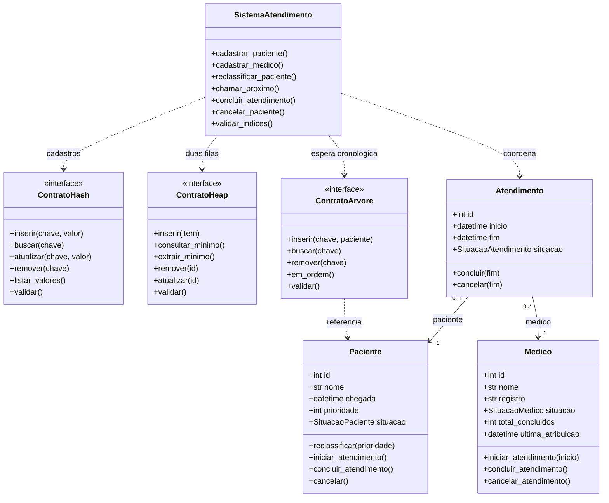

# SIGAE-09 — Arquitetura e contratos das classes

## Escopo e estado da implementação

Este documento define as interfaces e responsabilidades para o SIGAE WEB.
Não representa a implementação completa do sistema.

- Existentes: base Django, entidades `Paciente`, `Medico` e `Atendimento`,
  `TabelaHash`, `MinHeap`, `ArvoreRubroNegra` e `SistemaAtendimento`. O serviço
  coordena entidades e estruturas em memória, independentemente das views.
- Interface existente: seis protótipos navegáveis — Painel geral, Pacientes,
  Triagem/Fila, Médicos, Atendimentos e Histórico — com dados fictícios estáticos,
  views somente GET e ações de negócio desabilitadas. Telas, URLs, limitações e
  revisão pendente estão em [prototipos.md](prototipos.md).
- Contratos: `Identificavel`, `ContratoHash`, `ContratoHeap` e `ContratoArvore`
  em `atendimentos/contratos.py` (Protocols do Python).
- Implementados no serviço: IDs, cadastros, consultas, triagem no cadastro,
  reclassificação, chamada, distribuição médica, conclusão, cancelamento,
  históricos e indicadores, com compensação local em caso de falha.
- Pendentes: formulários e integração das operações com a interface WEB.
- SIGAE-20: instância compartilhada entre requisições, concorrência, locks,
  rollback centralizado e indisponibilidade após falha de recuperação.
- Validação da SIGAE-19: 160 testes aprovados, incluindo três novos cenários
  integrados da SIGAE-19.9 sobre os 157 testes anteriores. Validam fluxo,
  distribuição, referências, invariantes, colisões, redimensionamentos e
  recuperação local; não comprovam concorrência ou integração WEB.

Um Protocol descreve métodos e tipos para análise estática. Não implementa
algoritmos, não verifica regras de negócio em execução e não exige herança
explícita. Os testes das implementações verificam os comportamentos no recorte existente.

## Organização dos arquivos

| Local | Responsabilidade |
| --- | --- |
| `config/` | Configurações do Django e rotas principais |
| `atendimentos/domain/` | Entidades e validações, independentes do Django |
| `atendimentos/structures/` | Hash, Heap e Rubro-Negra implementados pela equipe |
| `atendimentos/services/` | Operações de negócio, coordenação de índices e recuperação de falhas |
| `atendimentos/contratos.py` | Interfaces das estruturas |
| `atendimentos/forms.py` | Conversão e validação das entradas web; arquivo futuro |
| `atendimentos/views.py` | Receber requisições, chamar o serviço e renderizar respostas |
| `templates/atendimentos/` | Templates centralizados |
| `css/` | Arquivos CSS centralizados na raiz |
| `atendimentos/tests/` | Testes de entidades, estruturas, integração e interface |

As views atuais apenas renderizam os protótipos e não alteram entidades ou índices.
O serviço já controla as operações completas em execução sequencial; a integração
com as views é futura. Domínio e
estruturas não importam views, formulários ou modelos do Django. O serviço não
deverá ser recriado com filas vazias a cada requisição; sua instância seguirá a
estratégia em memória da SIGAE-10 abaixo, sem persistência.

## SIGAE-10 — Estado em memória e acesso entre requisições

A SIGAE-19 mantém o estado enquanto a instância do serviço existir; instâncias
separadas possuem índices e contadores independentes. As compensações locais
restauram valores nas entidades originais e recompõem índices recuperáveis pelas
APIs existentes. IDs reservados não são reutilizados. Falhas de recuperação são
propagadas por `ExceptionGroup`, sem bloqueio automático do serviço. O provedor,
os locks e o mecanismo centralizado descritos a seguir são pendências da SIGAE-20.

### Ciclo de vida e acesso pelas views

O sistema executará em um único processo servidor, com uma instância de
`SistemaAtendimento` compartilhada por todas as requisições e usuários desse
processo. O estado não pertence à sessão de navegador nem à instância de uma view.
Um provedor futuro em `atendimentos/services/estado.py` oferecerá
`obter_sistema()`, criando a instância uma única vez, sob lock de inicialização,
e retornando sempre a mesma referência. A instância só será publicada depois
de sua construção completa; falha de inicialização não publicará estado parcial.

As views importarão esse provedor, obterão o serviço e chamarão suas operações.
Não construirão serviços por requisição nem acessarão diretamente as estruturas.
O serviço manterá um `threading.RLock` único para proteger leituras e alterações;
métodos compostos manterão esse lock durante toda a operação, inclusive rollback.
A reentrância permite chamadas internas protegidas sem adquirir um segundo lock
para o mesmo estado. O lock de inicialização não será usado nas operações de negócio.

Para renderização, o serviço oferecerá um contexto de leitura protegido pelo
mesmo lock. Dentro dele, a view consultará os métodos existentes e materializará
os campos necessários em valores de apresentação, sem guardar referências
mutáveis para leitura posterior. A renderização ocorrerá após liberar o lock.
As listas retornadas pelas estruturas continuam contendo referências, conforme
os contratos; copiar apenas a lista não constitui uma fotografia dos seus campos.
Valores auxiliares de apresentação não serão cadastros nem índices alternativos.

Durante a execução, preservar cadastros, atendimentos ativos e históricos,
referências compartilhadas, índices, geradores de IDs, contadores de conclusões
e última atribuição dos médicos. Concluir ou cancelar não apaga o cadastro ou
histórico. IDs serão gerados sob o lock, serão crescentes e não serão reutilizados
durante essa execução; reservas em operações que falhem poderão deixar lacunas.
Contadores médicos só mudam pelas regras de conclusão e não reiniciam entre
requisições, acessos de usuários ou novas sessões de navegador.

### Operações compostas e rollback

Cadastro, reclassificação, chamada, conclusão e cancelamento deverão seguir:

1. Adquirir o lock do serviço e validar entradas, existência, estados e
   disponibilidade antes de alterar registros. Sem médico ou paciente elegível,
   encerrar com o erro previsto, sem retirar itens das filas.
2. Registrar os valores anteriores das entidades afetadas, vínculos e presença
   nos índices, e preparar as compensações antes das mutações. Usar um registro
   temporário de recuperação, com listas/tuplas e referências originais,
   justificado exclusivamente pelo rollback, sem substituir estruturas próprias.
3. Aplicar a operação completa sob o mesmo lock, registrando as etapas concluídas.
   Só devolver sucesso quando estados, vínculos, contadores e índices forem
   consistentes. Nenhuma outra requisição poderá observar etapas intermediárias.
4. Em falha, compensar as etapas em ordem inversa, restaurar valores nas mesmas
   instâncias e recompor os índices com essas referências. Na reclassificação,
   restaurar a prioridade e reorganizar o Heap; na conclusão, restaurar também
   contador, disponibilidade, atendimento e vínculos. IDs reservados permanecem
   consumidos, sem registros parciais associados a eles.
5. Conferir os invariantes após a recuperação antes de liberar o acesso normal.
   Se o rollback falhar, marcar o serviço como indisponível sob o lock e rejeitar
   novas operações e consultas de negócio; não continuar usando estado incerto
   nem apresentar sucesso. Registrar a falha para diagnóstico.

O lock impede interferência concorrente, mas não desfaz alterações sozinho.
Na integração das estruturas existentes, deverá ser garantido que falhas em uma
mutação sejam recuperáveis, inclusive quando ocorram antes de o método retornar.
Os Protocols atuais não oferecem transações nem restauração de entidades.
A recuperação local está implementada na SIGAE-19; a coordenação sob lock e o
rollback centralizado permanecem para a SIGAE-20, preservando os contratos. Restaurar estado
não significa executar transições de negócio proibidas nem substituir entidades
por cópias independentes. Os testes existentes injetam falhas entre etapas e
verificam invariantes e identidade das referências. Testes de comportamento
concorrente permanecem futuros.

### Limitações e compatibilidade

- Reinício, encerramento ou falha do processo perde todo o estado em memória,
  inclusive histórico, IDs e contadores. A próxima execução começa vazia, com
  geradores reinicializados; não há garantia de unicidade entre execuções.
- Múltiplos workers, processos ou réplicas não são suportados: cada um teria
  serviço, filas e IDs independentes. O lock protege apenas threads do mesmo
  processo e não sincroniza essas cópias.
- O autoreload de desenvolvimento reinicia o processo e perde o estado. Para
  sessões de demonstração contínuas, executar com autoreload desativado
  (`python manage.py runserver --noreload`). Isso não fornece persistência.
- Um lock único serializa operações e pode limitar a vazão; evitar renderização
  e I/O demorado dentro da região protegida. Os históricos crescem na memória.
- A estratégia é compatível com o escopo, que torna banco opcional, e preserva
  domínio independente do Django, estruturas próprias, contratos e coordenação
  centralizada. Persistência e distribuição entre processos exigiriam outra
  estratégia futura e não fazem parte desta entrega.

A SIGAE-10 documenta essas decisões; não implementa o provedor, locks, serviço,
estruturas, rollback ou persistência, nem declara comprovados seus testes futuros.

## Entidades

### Paciente — implementado

Campos: `id: int`, `nome: str`, `chegada: datetime`, `prioridade: int`,
`situacao: SituacaoPaciente`.

- ID positivo, atribuído pelo serviço; unicidade conferida na Hash.
- Nome obrigatório; chegada com fuso horário; prioridade inteira de 1 a 5.
- ID e chegada não mudam enquanto o registro existir.
- `chave_chegada = (chegada, id)`.
- `chave_prioridade = (prioridade, chegada, id)`.
- `reclassificar(prioridade)` só aceita Aguardando.
- `iniciar_atendimento()`: Aguardando para Em atendimento.
- `concluir_atendimento()`: Em atendimento para Concluído.
- `cancelar()`: Aguardando ou Em atendimento para Cancelado.
- Transição inválida gera `ValueError` sem mudar a situação.

Os métodos da entidade não atualizam estruturas. O serviço deve coordená-los
com a fila, os vínculos e a recuperação de falhas.

### Medico — implementado

Campos: `id: int`, `nome: str`, `registro: str`, `situacao: SituacaoMedico`,
`total_concluidos: int`, `ultima_atribuicao: datetime | None`.

- ID automático e positivo; nome e registro fictício não vazios.
- Inicia Disponível, com zero conclusões e última atribuição `None`.
- `iniciar_atendimento(inicio)`: exige Disponível, registra a atribuição e ocupa o médico.
- `concluir_atendimento()`: exige Em atendimento, incrementa uma vez e libera.
- `cancelar_atendimento()`: exige Em atendimento e libera sem incrementar.
- Conclusão e cancelamento preservam a última atribuição.
- Tentativas inválidas geram `ValueError` sem alterar contador ou situação.

O serviço valida o atendimento associado antes de executar esses métodos,
evitando que uma solicitação antiga encerre uma consulta nova.

### Atendimento — implementado

Campos: `id: int`, `paciente: Paciente`, `medico: Medico`,
`inicio: datetime`, `fim: datetime | None`, `situacao: SituacaoAtendimento`.

- Criado pelo serviço apenas depois de selecionar paciente e médico elegíveis.
- Inicia Em atendimento; `fim` começa como `None`.
- `concluir(fim)` e `cancelar(fim)` encerram apenas um atendimento ativo.
- Encerramento deve ter fuso e não pode anteceder o início.
- Preserva referências a paciente e médico após encerrar, para histórico.
- Não incrementa contador do médico sozinho: a coordenação pertence ao serviço.

## Fonte dos registros e índices

| Estrutura | Conteúdo e propriedade |
| --- | --- |
| `TabelaHash[Paciente]` | Cadastro de todos os pacientes, inclusive encerrados |
| `ArvoreRubroNegra` | Referências aos pacientes Aguardando, por chegada e ID |
| `MinHeap[Paciente]` | Referências aos mesmos pacientes Aguardando, por urgência |
| `TabelaHash[Medico]` | Cadastro de todos os médicos |
| `MinHeap[Medico]` | Referências apenas aos médicos Disponíveis |
| `TabelaHash[Atendimento]` | Atendimentos ativos e encerrados, consultáveis por ID |
| Hash interna de cada Heap | ID do item para sua posição na lista do Heap |

Cada paciente possui uma única instância compartilhada pelos índices. Não criar
cópias independentes do paciente em cada estrutura. A mesma regra vale para médicos.
O atendimento tem ID próprio e referências às entidades existentes.

A árvore não precisa conter pacientes concluídos ou cancelados. Por isso,
a igualdade de IDs é exigida entre árvore, Heap de pacientes e subconjunto
Aguardando do cadastro, não entre todos os registros da Hash e a fila.

## Contratos das estruturas

As assinaturas oficiais estão em `atendimentos/contratos.py`.

| Interface | Operação | Resultado ou erro |
| --- | --- | --- |
| Hash | `inserir(chave, valor)` | `None`; duplicidade gera `ValueError` |
| Hash | `buscar(chave)` | Valor ou `None` se ausente |
| Hash | `atualizar(chave, valor)` | `None`; ausente gera `KeyError` |
| Hash | `remover(chave)` | Valor removido; ausente gera `KeyError` |
| Hash | `listar_valores()` | Nova lista de referências, sem ordem garantida |
| Heap | `inserir(item)` | `None`; ID duplicado gera `ValueError` |
| Heap | `consultar_minimo()` | Referência à raiz ou `None` se vazio |
| Heap | `extrair_minimo()` | Registro removido; vazio gera `IndexError` |
| Heap | `remover(id)` | Registro removido; ausente gera `KeyError` |
| Heap | `atualizar(id)` | Reorganiza após mudança da chave; ausente gera `KeyError` |
| Árvore | `inserir(chave, paciente)` | `None`; duplicidade ou chave divergente gera `ValueError` |
| Árvore | `buscar(chave)` | Paciente ou `None` se ausente |
| Árvore | `remover(chave)` | Paciente removido; ausente gera `KeyError` |
| Árvore | `em_ordem()` | Nova lista de referências em ordem crescente |
| Todas | `__len__()` | Quantidade de registros, sem percorrer toda a estrutura |
| Todas | `validar()` | `None` se válida; inconsistência gera `ValueError` |

`None` não será armazenado como valor na Hash: ele representa uma busca sem resultado.
As implementações devem rejeitar erros de entrada antes de modificar o estado.
Os métodos de listagem não permitem que alterar a lista retornada altere os nós ou
buckets internos; seus elementos continuam sendo referências às entidades.

### Configuração das estruturas implementadas

- `TabelaHash(capacidade=11, fator_carga_maximo=0.75)`: capacidade positiva,
  função `id % capacidade`, encadeamento separado e redimensionamento com rehash.
  A capacidade dobra até comportar a próxima inserção dentro do fator máximo;
  remoções não reduzem a capacidade. Implementa todas as operações de `ContratoHash`.
  Esses valores são escolhas do projeto, não números obrigatórios do enunciado.
- `MinHeap(chave)`: recebe uma função que produz uma tupla comparável a partir
  do item. Usa lista e Hash própria de posições. A função deve ser determinística
  e não alterar o item. Trocas atualizam as duas posições na Hash. Implementa
  `ContratoHeap`; os critérios de pacientes e médicos são configurados pelo
  chamador. Há testes com objetos fictícios e com a entidade `Medico` implementada.
- `ArvoreRubroNegra()`: inicia vazia, com sentinela NIL preta; rotações,
  recolorações e correções são detalhes internos. Implementa `ContratoArvore`,
  inclusive correção após remoção e validação dos invariantes.

As três estruturas preservam referências aos objetos. Seus testes verificam
operações isoladas e invariantes; os testes do serviço verificam também a
consistência conjunta de cadastros, filas, estados e vínculos na execução sequencial.
As complexidades detalhadas, incluindo custos da Hash auxiliar do Heap e dos
validadores, estão nas docstrings das classes em `atendimentos/structures/`.

Critério de pacientes: `(prioridade, chegada, id)`; menor valor vence.
Critério de médicos: `(total_concluidos, ultima_atribuicao_ou_minimo, id)`.
Para nunca atribuídos, usar uma data sentinela anterior às atribuições válidas,
com fuso UTC. Assim, com contadores iguais, nunca atribuídos precedem os demais;
entre eles, vence o menor ID. Todas as comparações usam datas com fuso.

### Complexidades esperadas

- Hash: consulta, atualização e remoção O(1) em média, O(n) no pior caso.
  Inserção tem custo esperado amortizado O(1); redimensionar custa O(n).
- Heap: consultar mínimo O(1); inserir/extrair/atualizar/remover reorganizam
  O(log n) posições. A Hash interna tem os custos acima; não afirmar limite
  estrito de O(log n) para o custo total em todos os casos de colisão/rehash.
- Rubro-Negra: busca, inserção e remoção O(log n); percurso completo O(n).
- Validações e geração de listagens são operações separadas e podem percorrer índices.

## Serviço central — implementado em memória

`SistemaAtendimento` instancia as Hashes, os dois Heaps e a árvore.
Também controla os geradores de IDs de pacientes, médicos e atendimentos.
Os contadores são crescentes e nunca são calculados pelo tamanho das filas.

| Método | Retorno e regra |
| --- | --- |
| `cadastrar_paciente(nome, chegada, prioridade)` | `Paciente`; gera ID e inclui nos três índices apropriados |
| `buscar_paciente(id)` | `Paciente` ou `None`; consulta a Hash própria |
| `listar_fila()` | `list[Paciente]`; percurso em ordem da árvore |
| `reclassificar_paciente(id, prioridade)` | `Paciente`; modifica risco e reorganiza Heap como uma operação |
| `cadastrar_medico(nome, registro)` | `Medico`; gera ID e inclui cadastro e Heap de disponíveis |
| `buscar_medico(id)` | `Medico` ou `None` |
| `listar_medicos()` | `list[Medico]`; sem ordem garantida |
| `chamar_proximo(inicio=None)` | `Atendimento`; indisponibilidade gera `ValueError`, preservando filas |
| `concluir_atendimento(id, fim=None)` | `Atendimento` encerrado; não permite conclusão repetida |
| `cancelar_paciente(id, fim=None)` | `Paciente` cancelado; se ativo, encerra vínculo e libera médico |
| `listar_atendimentos_ativos()` | `list[Atendimento]` filtrada por Em atendimento |
| `listar_historico()` | `list[Atendimento]` encerrados, ordenada por início e ID |
| `listar_chegadas()` | `list[Paciente]` de todos os estados, ordenada por chegada e ID |
| `obter_indicadores()` | Totais e estados de pacientes, médicos e atendimentos; conclusões por médico |
| `listar_pacientes()` | `list[Paciente]` de todos os estados, sem ordem garantida |
| `consultar_proximo_paciente()` | Mínimo clínico ou `None`, sem extração |
| `consultar_proximo_medico()` | Médico disponível mínimo ou `None`, sem extração |

`validar_indices()` permanece previsto para a integração centralizada; não existe
como método público nesta etapa. Os testes integrados combinam os validadores das
estruturas e verificações dos vínculos. Horários omitidos usam o instante atual
em UTC. O cancelamento em espera valida o horário, mas não cria atendimento.

Operações de alteração com ID inexistente geram `KeyError`; dados ou transições
inválidas geram `ValueError`. Na integração WEB futura, as views deverão traduzir esses erros em mensagens
para o operador. Erros inesperados não podem ser apresentados como sucesso.
Os indicadores retornam totais, contagens por estado e uma lista de conclusões
por médico. Dicionários auxiliares são apenas saída de apresentação, sem índices
ou contadores persistentes adicionais. A adaptação ao frontend é futura.

A lista cronológica histórica pode ordenar uma lista auxiliar obtida do cadastro,
com custo O(n log n), pois os encerrados não estão na árvore de espera. Esse uso
auxiliar não substitui a árvore na listagem da fila nem o Heap na chamada.

## Colaboração nas operações

### Cadastro e reclassificação

Cadastro valida, gera ID, cria um único paciente e inclui na Hash, árvore e Heap.
Reclassificação consulta a Hash, verifica Aguardando, altera a prioridade e chama
`heap.atualizar(id)`. ID e chegada permanecem iguais. O serviço deve restaurar
registro e índices se uma etapa falhar.

### Chamada

Dentro de uma operação protegida contra concorrência, verificar ambas as filas.
Selecionar o paciente prioritário e o médico elegível, remover o paciente dos
índices de espera e o médico do Heap de disponíveis, atualizar as situações e
registrar o atendimento. Sem médico, nada sai da fila. Uma falha intermediária
deve restaurar o estado anterior. A distribuição médica não altera a prioridade clínica.

### Conclusão

Buscar o atendimento pelo seu ID, exigir que esteja ativo, registrar encerramento,
concluir o paciente, incrementar uma vez o contador e liberar/reinserir o médico.
Solicitação repetida é rejeitada antes de alterar qualquer contador. Preservar
o registro de atendimento e sua associação ao médico e paciente.

### Cancelamento

Se Aguardando, retirar paciente da árvore e Heap e marcar Cancelado.
Se Em atendimento, encerrar o atendimento associado, cancelar paciente e liberar
o médico sem aumentar o contador. Preservar o histórico e a última atribuição.
Concluídos e cancelados não são encerrados novamente.

### Invariantes globais

- Árvore e Heap de pacientes contêm exatamente os pacientes Aguardando.
- Heap de médicos contém exatamente os médicos Disponíveis.
- Cada paciente/médico participa de no máximo um atendimento ativo.
- Todo atendimento ativo referencia cadastros existentes e entidades Em atendimento.
- Contadores de médicos correspondem aos atendimentos Concluídos, excluindo cancelados.
- Nenhum índice contém IDs duplicados ou referências órfãs.

## Diagrama de classes

Abrir `diagrama_classes.drawio` no diagrams.net para editar ou exportar.
O diagrama em Markdown apresenta as entidades e o serviço existentes.
O método `validar_indices()` nele indicado permanece planejado. O arquivo draw.io
registra o desenho arquitetural e não comprova o estado da implementação.
Linhas tracejadas representam dependências; linhas contínuas, associações.

Para o recorte atual, cada cadastro de paciente tem no máximo um atendimento;
retorno futuro à unidade gera novo ID de atendimento/cadastro. O diagrama usa
essa multiplicidade. Cada médico pode ter vários atendimentos históricos,
mas no máximo um ativo por vez.

## Aceite da SIGAE-09

- Responsabilidades e dependências definidas acima.
- Assinaturas, retornos e erros das estruturas registrados em `contratos.py`.
- Contratos de entidades e do serviço especificados; entregas e pendências identificadas.
- Fonte dos registros, referências compartilhadas e invariantes definidos.
- Diagrama de classes incluído em Markdown e em formato editável draw.io.
- A equipe deve revisar o acordo antes de integrar implementações. Não registrar
  essa revisão como realizada sem que os integrantes a tenham feito.

Este cartão não implementa algoritmos, integração, persistência ou recuperação
de falhas e não comprova os testes das funcionalidades futuras.
